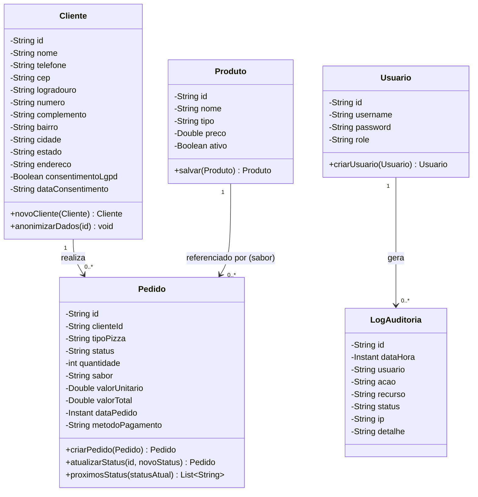
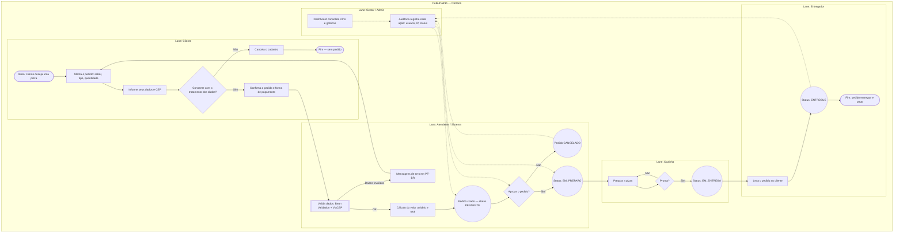
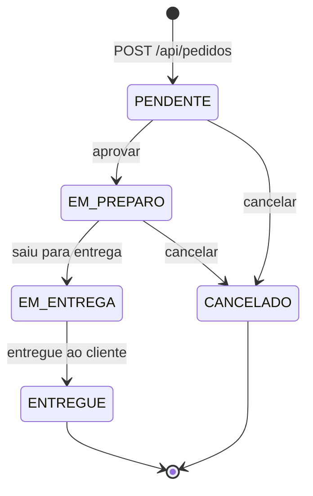
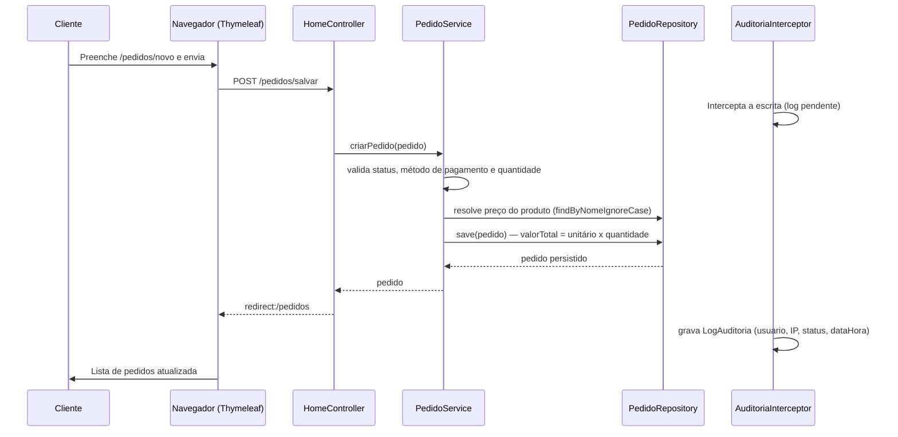

# Modelagem — Diagramas UML e BPMN

Os diagramas abaixo usam [Mermaid](https://mermaid.js.org/) e são renderizados
automaticamente pelo GitLab, GitHub e pela maioria dos editores Markdown.

---

## 1. Diagrama de Classes UML (entidades do sistema)

---

## 2. Diagrama BPMN — Fluxo de negócio do pedido (do pedido até a entrega)

> Pools e lanes: **Cliente**, **Atendente/Sistema**, **Cozinha**, **Entregador** e
> **Gestor**. Losangos são gateways; retângulos arredondados são atividades.

### 2.1 Diagrama de estados do pedido (máquina de estados)

Transições fora da tabela acima são rejeitadas com erro 400 por
`PedidoService.atualizarStatus` (fonte de verdade: `TRANSICOES`).

---

## 3. Diagrama de sequência — Registro de um pedido

